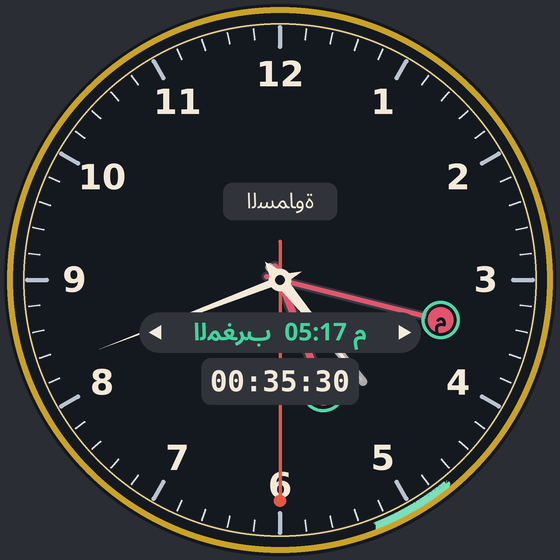
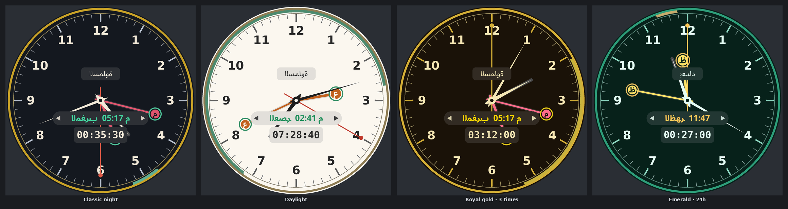
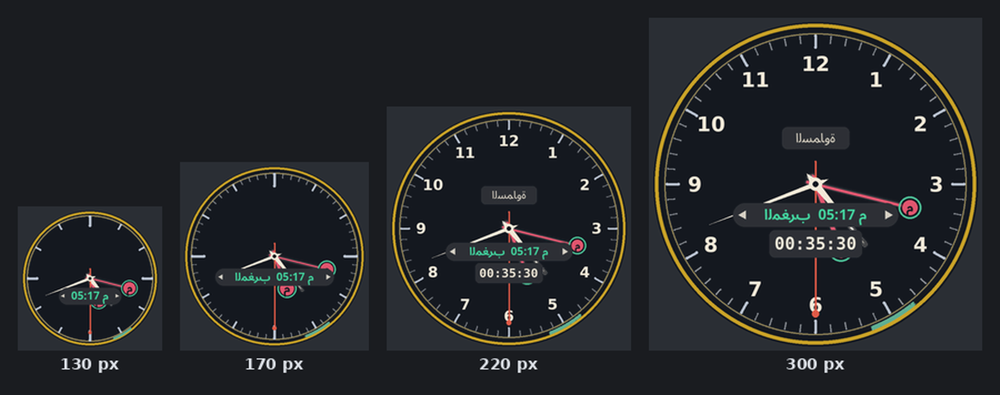
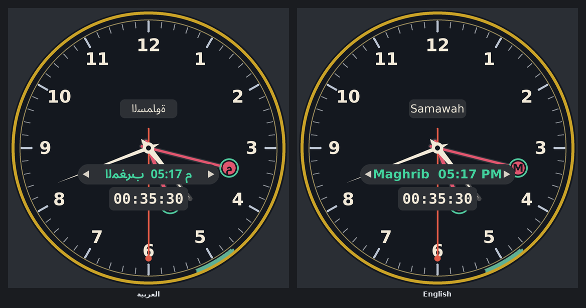

<div align="center">



# مواقيت · Mawaqit

**A classic desktop clock that shows Islamic prayer times with coloured hands**

**ساعة كلاسيكية لسطح المكتب تُظهر أوقات الصلاة بعقارب ملوّنة**

[English](#english) · [العربية](#العربية)

</div>

---

<a name="english"></a>

## English

Mawaqit sits on your Windows desktop as an ordinary analogue clock — and alongside
the usual hour, minute and second hands it draws **one prayer** with its own pair of
hands in its own colour, each tipped with the prayer's letter. You read the prayer
time off the dial exactly as you read the current time.

Everything is computed astronomically on your own machine. No internet, no account,
no telemetry.

<div align="center">

</div>

### Download

Grab `Mawaqit.exe` from the [Releases](../../releases) page and run it. There is
nothing to install.

**Requirements:** Windows 7 SP1 or later with .NET Framework 4.7.2 — already part of
Windows 10 and 11. On Windows 7 and 8.1 it is a one-time install from Microsoft.

On first run Windows SmartScreen may object because the file is not code-signed:
click **More info** then **Run anyway**.

### Reading the dial

- **Three pale hands** — the current hour, minute and second, as on any clock.
- **Two coloured hands** — the prayer being shown, each tipped with its letter:

  | F | D | A | M | I |
  |---|---|---|---|---|
  | Fajr | Dhuhr | Asr | Maghrib | Isha |

- **The arc near the rim** — how much of the way you are from now to that prayer.
- **The centre panel** — your city, the prayer and its time, and a countdown.

Only one prayer is shown at a time, so the dial never becomes a tangle. Click the
arrow at either end of the prayer line to step to another prayer; after twenty
seconds the clock returns to the upcoming one by itself.

A prayer whose time has passed is drawn faded, and its counter runs with a minus
sign to show how long ago it began.

### Using it

| Action | Result |
|---|---|
| Drag | Move the clock |
| Double-click | Open the settings |
| Right-click | Full menu |
| Click ◀ or ▶ | Step to another prayer |
| Mouse wheel | Resize, from 120 to 1200 pixels |
| `Ctrl` + wheel | Resize in bigger steps |

An icon stays in the notification area: double-click it to show or hide the clock,
right-click it for a short menu. Position, size and every setting are saved to
`%AppData%\Mawaqit\settings.xml`.

### Size

<div align="center">

</div>

As the clock shrinks it simplifies itself rather than letting its text shrink into
nothing: minute ticks go first, then the numerals — their place taken by bolder
marks at 12, 3, 6 and 9 — then the city name, then the countdown.

| Diameter | What is shown |
|---|---|
| 120–140 | The prayer time and the arrows |
| 150–170 | \+ the prayer's name and minute ticks |
| 180–190 | \+ the countdown |
| 200 and up | \+ the numerals |
| 220 and up | \+ the city name |

What never goes: the current-time hands, the prayer's two hands with their letter,
its time in writing, and the arrows. No text is ever drawn smaller than nine pixels,
and no panel ever covers the centre of the dial.

### Settings

<div align="center">

</div>

**Language** — Arabic or English, switched from the settings or straight from the
right-click menu. The interface, its direction, the prayer names and their letters,
the city and country names and the AM/PM markers all follow. On first run the
language is taken from Windows.

**Location** — 79 cities built in (every Iraqi governorate capital, the Arab and
Islamic capitals, and the major cities of the diaspora), or coordinates you type in
for anywhere else. The time zone comes from Windows by default, so daylight saving
is handled for you.

**How many times** — five (Fajr, Dhuhr, Asr, Maghrib, Isha) or three (Fajr, Dhuhr,
Maghrib, for those who join Dhuhr with Asr and Maghrib with Isha). The computed
times do not change; only which of them the clock shows and announces.

**Calculation** — eleven methods: Jafari, Karbala, University of Tehran, Muslim
World League, Egyptian General Authority, Umm al-Qura, Karachi, ISNA, Dubai, Kuwait
and Diyanet. Plus the Asr school (shadow ×1 or ×2), a higher-latitude rule, and a
manual adjustment in minutes for each time so you can match your mosque's calendar
exactly.

**Colours** — six presets, and a separate colour for every prayer and every part of
the clock.

**Appearance** — numeral style (Arabic-Indic ١٢٣, Western 123, Roman XII or none),
font, opacity, size, 12- or 24-hour times, and each element of the dial on or off.

**Behaviour** — always on top, lock position, let clicks pass through to the desktop,
notify when a prayer begins, start with Windows.

### Adding cities

Put a `cities.csv` file next to `Mawaqit.exe`, encoded UTF-8, one city per line:

```
ArabicName,EnglishName,Country,Latitude,Longitude,WindowsTimeZoneId,Offset,Method
الرفاعي,Rifai,العراق,31.6833,46.1058,Arabic Standard Time,3,Jafari
```

Latitude is positive north, longitude positive east. The time zone is its Windows
identifier, and the offset is a fallback used if that identifier is not found.

### Accuracy

The astronomical model is the standard one used for prayer timetables: solar
position, the equation of time, and twilight angles. Its output was checked against
an independent VSOP87 ephemeris at seven sites from Jakarta to Oslo across the
seasons — **the largest difference was under four seconds**.

A minute or two of difference from your mosque's calendar is normal and comes from
the angle it adopts, not from an error. Use the per-prayer manual adjustment to
match it.

At high latitudes the twilight may not occur at all on some days; the angle-based
rule is then applied, and you can change it.

### Building from source

Open `Mawaqit.sln` in Visual Studio and press `Ctrl+Shift+B`, or run `build.bat`.
There are no NuGet packages and no external dependencies.

Pushing a tag builds the executable on GitHub and attaches it to the release:

```
git tag v1.0
git push origin v1.0
```

---

<a name="العربية"></a>

## العربية

«مواقيت» ساعة تجلس على سطح مكتب ويندوز كأي ساعة بعقارب — وإلى جانب عقارب الساعة
والدقيقة والثانية ترسم **صلاة واحدة** بعقربَي ساعة ودقيقة لها، بلونها، وعلى رأس كلٍّ
منهما حرفها. فيُقرأ وقت الصلاة من القرص تماماً كما يُقرأ الوقت الحالي.

الحساب كله فلكي يجري على جهازك. بلا إنترنت، وبلا حساب، وبلا أي إرسال لبياناتك.

### التحميل

نزّل `Mawaqit.exe` من صفحة [الإصدارات](../../releases) وشغّله. لا يحتاج تنصيباً.

**المتطلبات:** ويندوز 7 SP1 فما فوق مع .NET Framework 4.7.2، وهو مُضمَّن أصلاً في
ويندوز 10 و11. وعلى ويندوز 7 و8.1 يُنصَّب مرة واحدة من موقع مايكروسوفت.

عند أول تشغيل قد يعترض Windows SmartScreen لأن الملف غير موقَّع رقمياً: اضغط
**More info** ثم **Run anyway**.

### قراءة القرص

- **العقارب الفاتحة الثلاثة** — الساعة والدقيقة والثانية، كأي ساعة.
- **العقربان الملوّنان** — الصلاة المعروضة، على رأس كلٍّ منهما حرفها:

  | ف | ظ | ع | م | ش |
  |---|---|---|---|---|
  | الفجر | الظهر | العصر | المغرب | العشاء |

  (العشاء بالشين لأن العين للعصر.)

- **القوس عند الإطار** — ما قطعتَه من المدة بين الآن وتلك الصلاة.
- **اللوحة الوسطى** — مدينتك، والصلاة ووقتها، والعدّ التنازلي.

تُعرض صلاة واحدة في كل مرة فلا يزدحم القرص. انقر السهم على طرف سطر الصلاة للانتقال
إلى غيرها، وبعد عشرين ثانية تعود الساعة إلى الصلاة القادمة من تلقائها.

والصلاة التي مضى وقتها تُرسم باهتة، ويعدّ عدّادها بإشارة ناقص ليدلّ على ما انقضى منذ
دخولها.

### الاستعمال

| الإجراء | النتيجة |
|---|---|
| السحب | تحريك الساعة |
| نقرة مزدوجة | فتح الإعدادات |
| الزر الأيمن | القائمة الكاملة |
| نقر ◀ أو ▶ | الانتقال إلى صلاة أخرى |
| عجلة الفأرة | التحجيم، من 120 إلى 1200 بكسل |
| `Ctrl` + العجلة | التحجيم بخطوات أكبر |

تبقى أيقونة في منطقة الإشعارات: نقرة مزدوجة عليها تُظهر الساعة أو تُخفيها، وزرها
الأيمن يفتح قائمة مختصرة. ويُحفظ الموضع والحجم وكل الإعدادات في
`%AppData%\Mawaqit\settings.xml`.

### الحجم

كلما صغرت الساعة بسّطت نفسها بدل أن يصغر خطّها حتى يختفي: تُحذف شعيرات الدقائق
أولاً، ثم الأرقام وتقوم مقامها شعيرات غليظة عند 12 و3 و6 و9، ثم اسم المدينة، ثم
العدّاد.

| القطر | ما يظهر |
|---|---|
| 120–140 | وقت الصلاة والسهمان |
| 150–170 | \+ اسم الصلاة وشعيرات الدقائق |
| 180–190 | \+ العدّاد التنازلي |
| 200 فأكثر | \+ الأرقام |
| 220 فأكثر | \+ اسم المدينة |

ولا يسقط أبداً: عقارب الوقت الحالي، وعقربا الصلاة بحرفها، ووقتها مكتوباً، والسهمان.
ولا يُرسم نص أصغر من تسعة بكسل، ولا تحجب لوحة مركز القرص.

### الإعدادات

**اللغة** — عربية أو إنكليزية، تُبدَّل من الإعدادات أو من قائمة الزر الأيمن مباشرة.
يتبعها كل شيء: نصوص الواجهة واتجاهها، وأسماء الصلوات وحروفها، وأسماء المدن
والبلدان، وصيغة ص/م. وعند أول تشغيل تُؤخذ اللغة من إعدادات ويندوز.

**الموقع** — 79 مدينة جاهزة (كل مراكز المحافظات العراقية، والعواصم العربية
والإسلامية، ومدن المهجر الكبرى)، أو إحداثيات تُدخلها لأي موقع آخر. والمنطقة الزمنية
تُؤخذ من ويندوز افتراضياً فيُراعى التوقيت الصيفي تلقائياً.

**عدد المواقيت** — خمسة (الفجر والظهر والعصر والمغرب والعشاء) أو ثلاثة (الفجر والظهر
والمغرب، لمن يجمع بين الظهرين وبين العشاءين). الأوقات المحسوبة لا تتغيّر، وإنما
يتغيّر ما يُعرض منها وما يُنبَّه عليه.

**الحساب** — إحدى عشرة طريقة: الجعفري، وكربلاء، وجامعة طهران، ورابطة العالم
الإسلامي، والهيئة المصرية، وأم القرى، وكراتشي، وISNA، ودبي، والكويت، وديانت.
ومعها مذهب العصر (ظل المثل أو المثلين)، ومعالجة خطوط العرض العالية، وتعديل يدوي
بالدقائق لكل وقت لمطابقة تقويم مسجدك تماماً.

**الألوان** — ست مجموعات جاهزة، ولونٌ منفصل لكل صلاة ولكل جزء من الساعة.

**المظهر** — شكل الأرقام (عربية هندية ١٢٣، أو غربية 123، أو رومانية XII، أو بلا
أرقام)، والخط، والشفافية، والحجم، ونظام 12 أو 24 ساعة، وإظهار أو إخفاء كل عنصر.

**السلوك** — دائماً في المقدمة، وتثبيت المكان، وتمرير النقر إلى ما خلف الساعة،
والتنبيه عند دخول الوقت، والتشغيل مع بدء ويندوز.

### إضافة مدن

ضع ملف `cities.csv` بجانب `Mawaqit.exe` بترميز UTF-8، سطراً لكل مدينة:

```
الاسم العربي,الاسم الإنكليزي,البلد,خط العرض,خط الطول,المنطقة الزمنية,الفرق,الطريقة
الرفاعي,Rifai,العراق,31.6833,46.1058,Arabic Standard Time,3,Jafari
```

خط العرض موجب شمالاً، وخط الطول موجب شرقاً. والمنطقة الزمنية اسمها في ويندوز،
والفرق بديلٌ يُستعمل إن لم تُوجد.

### دقة الحساب

النموذج الفلكي هو المعتمد في حساب المواقيت: موضع الشمس، ومعادلة الزمن، وزوايا
الشفق. وقد قُورنت مخرجاته بمرجع فلكي مستقل مبني على VSOP87 في سبعة مواقع تمتد من
جاكرتا إلى أوسلو وعلى مدار الفصول: **أكبر فرق كان أقل من أربع ثوانٍ**.

وفرق الدقيقة أو الدقيقتين عن تقويم مسجدك أمر طبيعي يعود إلى اختلاف الزاوية
المعتمدة لا إلى خطأ في الحساب؛ استعمل التعديل اليدوي بالدقائق لمطابقته.

وعند خطوط العرض العالية قد لا يتحقق الشفق أصلاً في بعض الأيام، فتُطبَّق قاعدة «نسبة
الزاوية»، ويمكن تغييرها.

### البناء من المصدر

افتح `Mawaqit.sln` في Visual Studio واضغط `Ctrl+Shift+B`، أو شغّل `build.bat`.
لا حزم NuGet ولا أي اعتماد خارجي.

ودفع وسم جديد يبني الملف التنفيذي على GitHub ويرفقه بالإصدار:

```
git tag v1.0
git push origin v1.0
```

---

<div align="center">

**مواقيت · Mawaqit**

</div>
